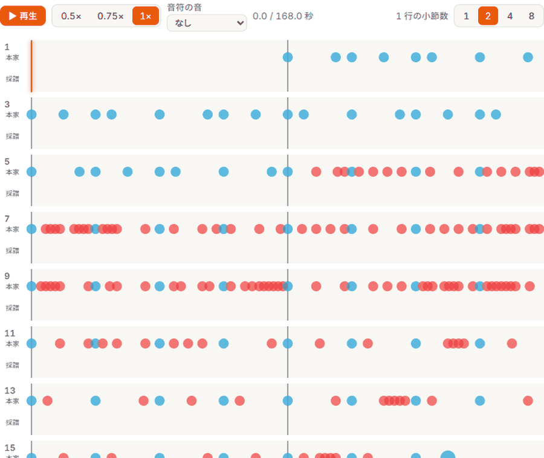
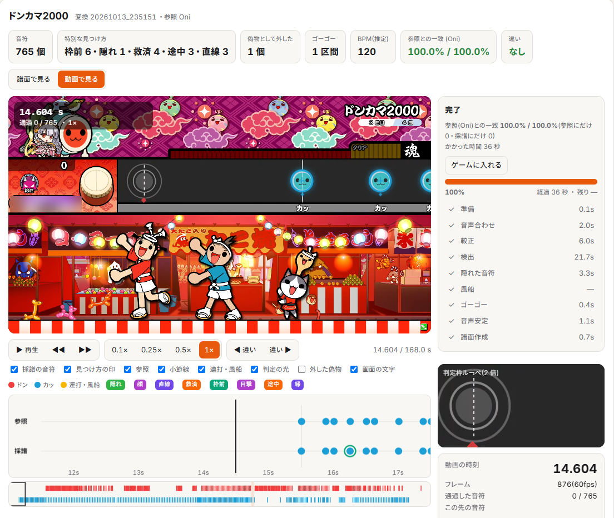
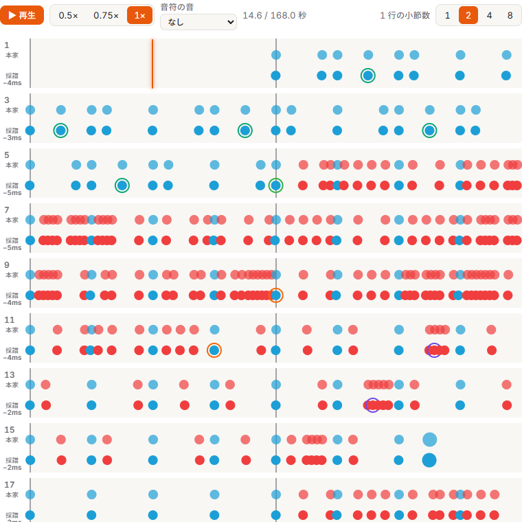
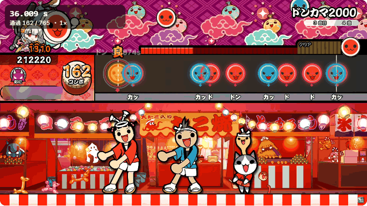

# video2tja

太鼓の達人のプレイ動画（画面録画）から、TJA形式の譜面を作ります。音符は映像から読み取ります。叩いた音は使いません。



変換中の画面です。読み取った音符が、譜面の形で増えていきます。上の段が既にある譜面、下の段が読み取った譜面です。

## できること

### 譜面を読み取る

- 読み取るものは、ドン・カッ、大音符、連打（小・大）とその終わり、風船とその打数、小節線、ゴーゴータイムです。
- 速さの違う音符に追い越されて隠れた音符も読み取ります。音符の白い縁の円がフレームをまたいで一直線に並ぶことを手がかりにします。
- 多重スクロール（1小節の中に速さの違う音符が混ざる譜面）は、音符ごとの速さからBPMとSCROLLを決めて書きます。
- 判定枠で止まる音符、画面の途中から現れる音符、判定枠の手前で1〜2枚だけ写る音符も扱います。
- 風船の打数は、叩いている間に出る吹き出しの数字を読みます。

### 譜面を書き出す

- 小節線を区切りにして、小節ごとにBPM・拍子・SCROLLを決めます。普通の格子に乗る小節は格子で書き、乗らない小節は音符ごとにBPMを刻んで書きます。
- 清書版（`out_clean.tja`）は、音符と小節線を5ms以内、流れる速さを3%以内に保ったまま、BPMとSCROLLの変更を最小にまとめた譜面です。人が書いた譜面に近い形になり、ゲームに入れるのに向きます。
- ゴーゴータイムは`#GOGOSTART`と`#GOGOEND`で書きます。連打は`5`から`8`、風船は`7`と`#BALLOON`の打数で書きます。

### 音源と時刻を合わせる

- 曲ライブラリに同じ曲があれば、動画の音声と音源を照合して、時刻の原点（OFFSET）を決めます。
- 動画の音声から、曲ライブラリの中の曲を自動で探します。曲名の分からない動画でも、曲フォルダを選ぶ手間がいりません。
- 曲ライブラリに無い曲は、動画の音声を切り出して音源にします。

### 録画の乱れを直す

- 30fpsの動画と、120fpsで録画した動画を扱えます。120fpsの動画は60fpsに直してから読みます。
- 録画側でフレームが重なった箇所や落ちた箇所は、レーンの流れと小節線の間隔から見つけて時刻を直します。
- 4Kや720pの動画は、画面の配置を測って合わせます。

### 答え合わせ

- 曲フォルダにその曲のTJAがあれば、読み取った譜面と突き合わせて、一致率と時刻のばらつきをログに出します。
- `regress/`の道具で、たくさんの動画をまとめて確かめられます。

### ブラウザの画面



- 変換中は、読み取った音符が譜面の形で増えていく様子を見られます。
- 終わると「譜面で見る」と「動画で見る」を切り替えられます。
- 譜面で見るでは、既にある譜面と上下に並べて見比べます。1行の小節数を1・2・4・8から選べ、音符にマウスを乗せると時刻が出ます。再生ボタンで音を流すと、再生位置が譜面の上を動きます。音符の音（ドン・カッ）を鳴らすこともできます。



- 動画で見るでは、動画の上に、読み取った音符と、どうやって見つけたかの印を重ねて再生します。0.1倍から1倍の速さ、1フレーム送り、判定枠のルーペがあります。



- 書き出したTJA（清書版とそのまま）と処理のログを画面で見られます。
- 「ゲームに入れる」を押すと、本家の音源とヘッダーに読み取ったコースを載せた曲フォルダを、曲ライブラリの`13 AI譜面`に作ります。

## 精度

1080p60のキャプチャ動画1100本で読み取り、音符の時刻・種類・大小がすべて正しいことを確かめました。音符の時刻のばらつきは、標準偏差1〜2msです。

## 処理時間

2分48秒の1080p60の動画（ドンカマ2000）を、Ryzen 9 9950X3D（16コア32スレッド）で読み取ったときの時間です。

| 使うCPU | 全体 | 内訳 |
|---|---|---|
| 8本（既定） | 38秒 | 音声合わせ2秒、画面の配置の測定6秒、音符の読み取り24秒、隠れた音符3秒、譜面作り1秒 |
| 全部（32本） | 33秒 | 音符の読み取りが19秒に縮みます |

時間は動画の長さにほぼ比例します。120fpsの録画は、60fpsに直す準備が1分ほど加わります。

## 必要なもの

- Python 3.12（確かめたのはこの版です）
- numpy、opencv-python、Pillow（`pip install -r requirements.txt`）
- ffmpegとffprobe（PATHに通しておきます）
- yt-dlp（一括試験でYouTubeから動画を取るときだけ使います）

## 使い方

### コマンドライン

```
python convert.py <動画> [--song <曲フォルダ>] [--no-song [--title <曲名>]] [--out <出力フォルダ>] [--install]
```

- `--song`は曲フォルダ（TJAと音源が入ったフォルダ）です。省くと、動画の音声から曲ライブラリの中を探します。はっきり決まらなければ候補を出して止まります。
- `--no-song`は曲ライブラリに無い曲のためのものです。動画の音声を切り出して音源にし、譜面を作ります。
- `--out`は出力フォルダです。省くと`testvideos/work/cli/<動画の名前>/`に書きます。
- `--install`は、出来た譜面を曲ライブラリの`13 AI譜面`に入れます。

出力フォルダには次のファイルができます。

| ファイル | 中身 |
|---|---|
| `out.tja` | 読み取った時刻をそのまま書いた譜面。音符ごとにBPMとSCROLLを刻みます |
| `out_clean.tja` | BPMとSCROLLの変更をまとめた清書版。ゲームに入れるならこちらです |
| `out_ons.json` | 読み取った音符・小節線・ゴーゴーの時刻（動画の秒） |
| `out.log` | 処理の記録。TJAがあれば答え合わせの結果も入ります |

### ブラウザの画面

```
python web/server.py
```

`http://127.0.0.1:8765/`を開き、左で動画と曲フォルダを選んで「変換を始める」を押します。動画はページに放り込んでも選べます。

### 曲ライブラリ

曲ライブラリは、環境変数`V2T_SONGS`で指定します。省いたときは、このフォルダの中の`Songs/`が対象です。中は`<ジャンル>/<曲フォルダ>/`の並びで、曲フォルダにはTJAと、そのWAVEに書かれた音源を置きます。

## 仕組み

1. 画面の配置（判定枠の位置とレーンの高さ）を測ります。
2. 音符の色の塊と白い縁の円を、フレームをまたいで追いかけ、判定枠に着く時刻を求めます。
3. 速さの違う音符に追い越されて隠れた音符は、白い縁の円の並びから拾います。
4. 小節線・ゴーゴータイム・連打の棒・風船の打数を、それぞれ画面から読みます。
5. 動画の音声と音源を照合して、時刻の原点（OFFSET）を決めます。
6. 小節線を区切りにして、BPM・拍子・SCROLLを決め、TJAに書き出します。

## 設定（環境変数）

| 名前 | 既定 | 働き |
|---|---|---|
| `V2T_SONGS` | `Songs/` | 曲ライブラリの場所 |
| `V2T_CPU` | `8` | 使うCPUの本数。`all`で全部使います |
| `V2T_PREP_ENC` | `cpu` | 120fpsの動画を60fpsに直すときの書き出し方。`nvenc`はGPUで書き出します。正確さは`cpu`の方が上です |
| `V2T_CLEAN` | `1` | `0`にすると清書版（`out_clean.tja`）を書きません |

## 対応している動画

- アーケード版（ニジイロ）の画面配置を前提にしています。1920×1080・60fpsの録画が基本です。
- 譜面分岐は書きません。分岐のある曲は、達人譜面の道を1本の譜面として書きます。

## ライセンス

MIT License
